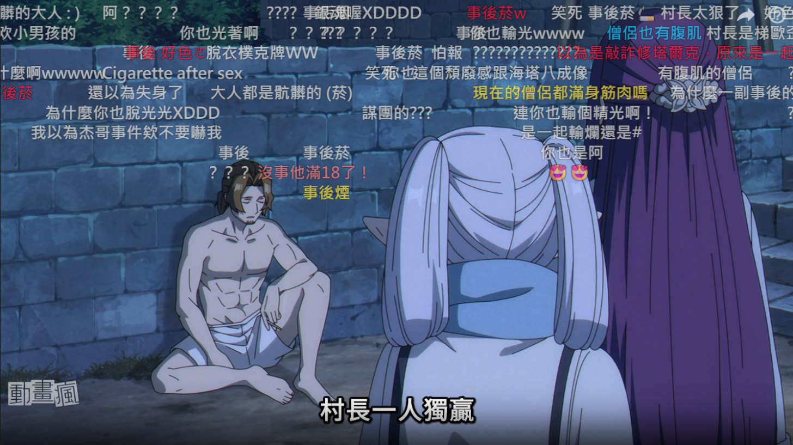
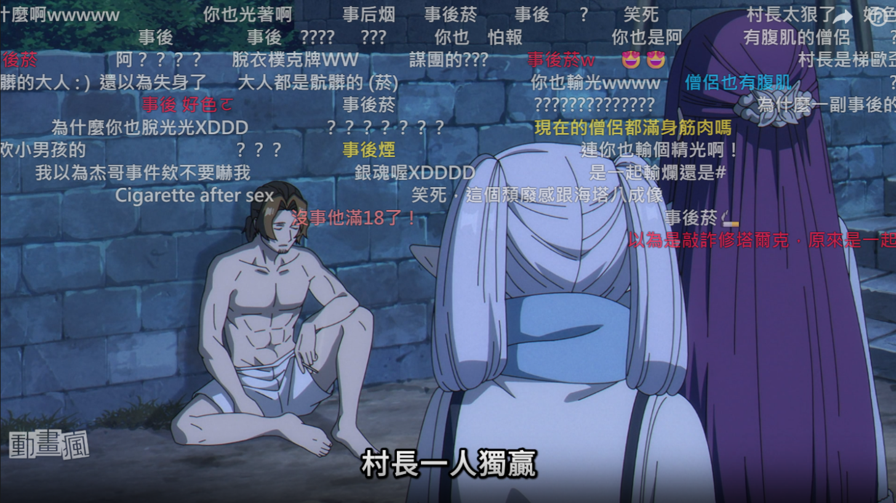

# 【巴哈JS腳本】動畫瘋彈幕防重疊

## 安裝流程
### step 1：安裝Tampermonkey
從[官網](https://www.tampermonkey.net/)找安裝
或是[Chrome商店](https://chromewebstore.google.com/detail/tampermonkey/dhdgffkkebhmkfjojejmpbldmpobfkfo)安裝
（請務必使用Tampermonkey，其他腳本管理軟體未經測試不保證能執行。）

### step 2：安裝腳本
點擊 https://greasyfork.org/zh-TW/scripts/604199
點安裝腳本 > 安裝

### step3（Chrome使用者）
在網址列輸入chrome://extensions/後按enter，將右上角的開發人員模式打開。

---

## 功能敘述
修正動畫瘋彈幕互相重疊的問題：
滾動彈幕不再從後面追撞前一條
滾動彈幕會避開頂部 / 底部彈幕
頂部 / 底部彈幕維持原位，彈幕排出的歌詞、圖案不會被打亂
畫面真的塞滿時，彈幕會放在重疊最少的位置

### 開啟前

### 開啟後

---

## 後記
歡迎裝我寫的其他腳本
[小屋](https://home.gamer.com.tw/profile/index_creation.php?owner=nathan60107&folder=425332)
https://greasyfork.org/zh-TW/users/223141-貝果
